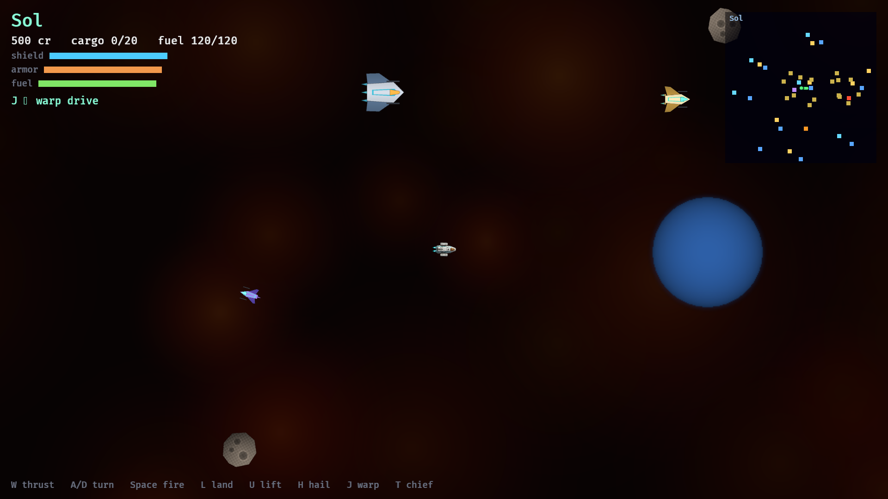
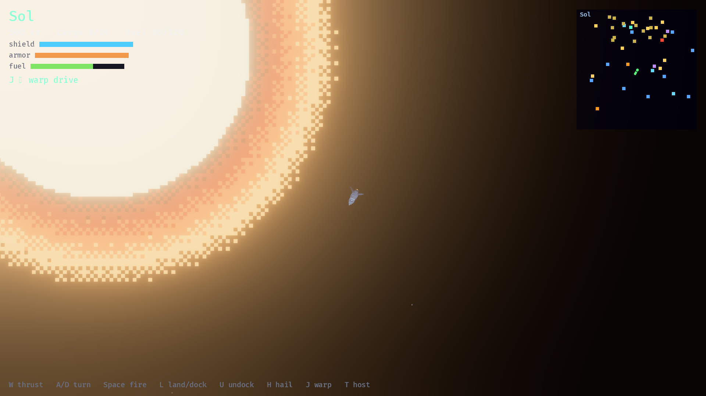
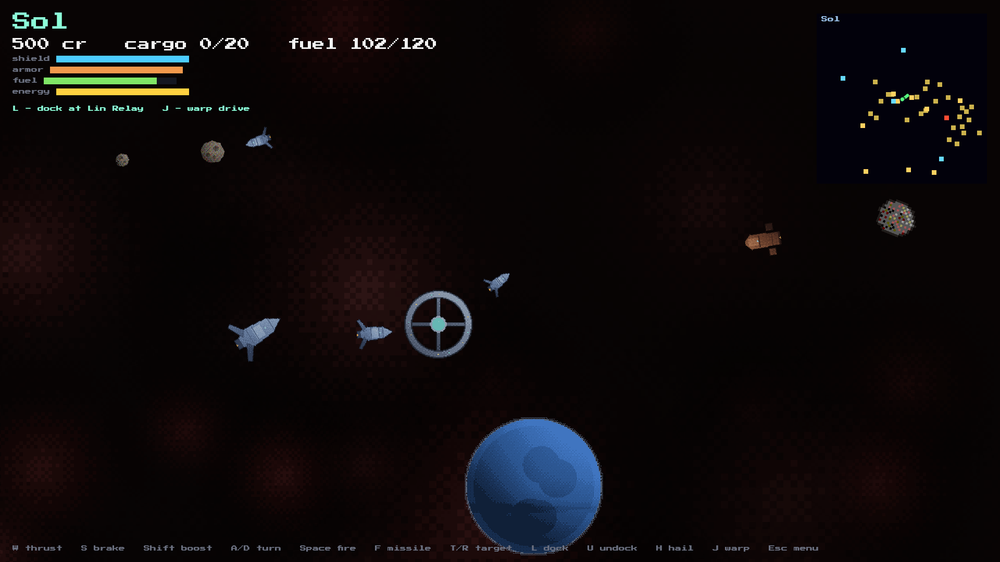
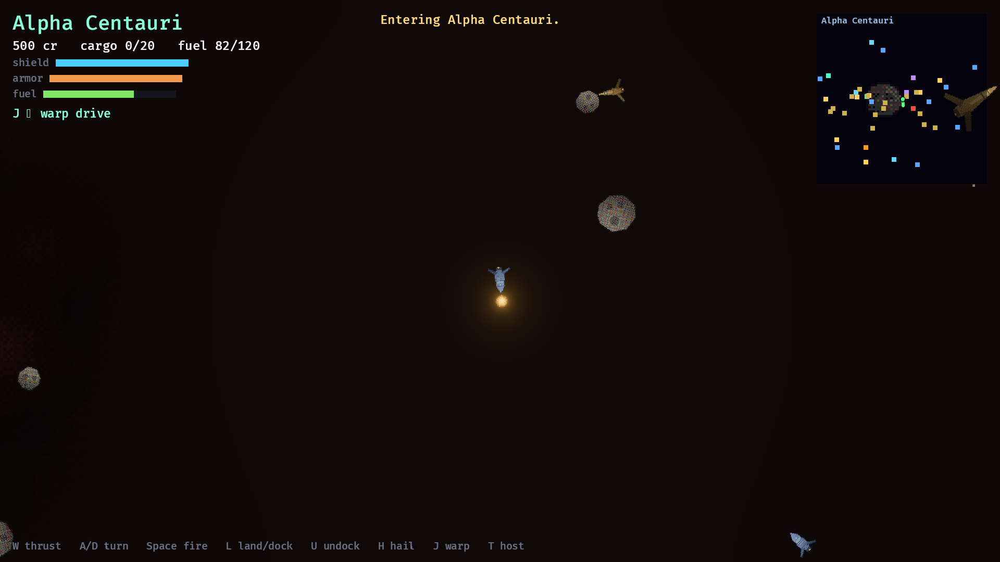
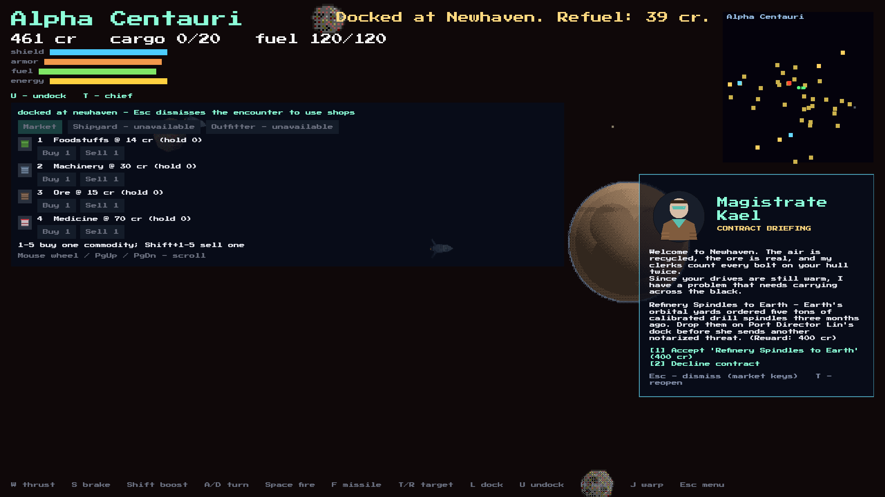
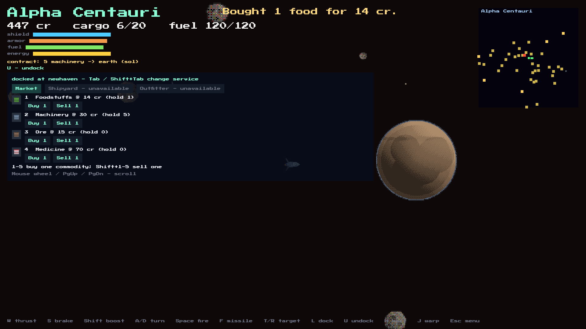

# Second Velocity: The Living Galaxy

*One galaxy, shared by pilots and minds.*

A community-shard MMO inspired by Escape Velocity (1996): 2D top-down space
trading, missions, and combat in a shared, persistent galaxy. Rust + Bevy,
server-authoritative, playable offline single-player through an embedded
server.

## Quickstart

```bash
cargo run -p sv-server 3456 --storage shard.db     # standalone shard (UDP :3456, persistent)
cargo run -p sv-client                            # offline single-player (embedded server)
cargo run -p sv-client -- --connect host:port --username you --password secret
cargo test --workspace                              # unit + end-to-end tests
```

## Screenshots








Captured through the game's MCP `capture_screenshots` tool. Build both
executables first with `cargo build -p sv-client -p sv-mcp`, then call
`capture_screenshots` with no arguments on `sv-game`.

The tool opens a separate desktop client, runs the automated tour, and refreshes
all six images only after the complete tour succeeds. It requires a working
desktop display, has a 180-second timeout, and does not change the MCP game
session. Errors return the capture log path.

The tour can also run directly: `cargo run -p sv-client -- --capture-tour`.
Use `--capture-dir path/to/output` to change the output directory. F12 saves a
screenshot anytime during normal play.

## Structure

| Path | What |
|---|---|
| `crates/` | sv-core (sim), sv-data (content), sv-protocol (wire), sv-server, sv-client, sv-mcp (MCP server) |
| `content/` | RON content packs — data, not code |
| `docs/gdd/` | game design (README is the index) |
| `docs/decisions/` | ADRs — the why behind everything |
| `docs/ideas/` | idea inbox, never deleted |
| `prompts/` | curated prompt library |
| `.opencode/skills/` | agent workflows |
| `ops/` | placeholder art generator, deployment (future) |

Agents: start at [AGENTS.md](AGENTS.md). Humans: start at
[docs/gdd/README.md](docs/gdd/README.md).

The game is also playable by agents: `sv-mcp` exposes the sim as an MCP
server (registered as `sv-game` in opencode.json) — observe, fly, trade,
fight, and warp through tool calls. See `crates/mcp`.

## Milestones

- **M0** — workspace + content pipeline ✅
- **M1** — offline vertical slice: fly, trade, fight, hyperjump ✅
- **M2** — real networking: standalone server, 2+ players, per-system rooms, govt-zone PvP ✅
- **M3** — persistence: accounts, login gate, SQLite player state ✅
- **M3.5** — continuous galaxy: warp drive replaces hyperjump, 11-system shared plane, minimap, MCP auto-reconnect ✅
- **M4** — community playtest: shared economy tick, faction meta-game, ops